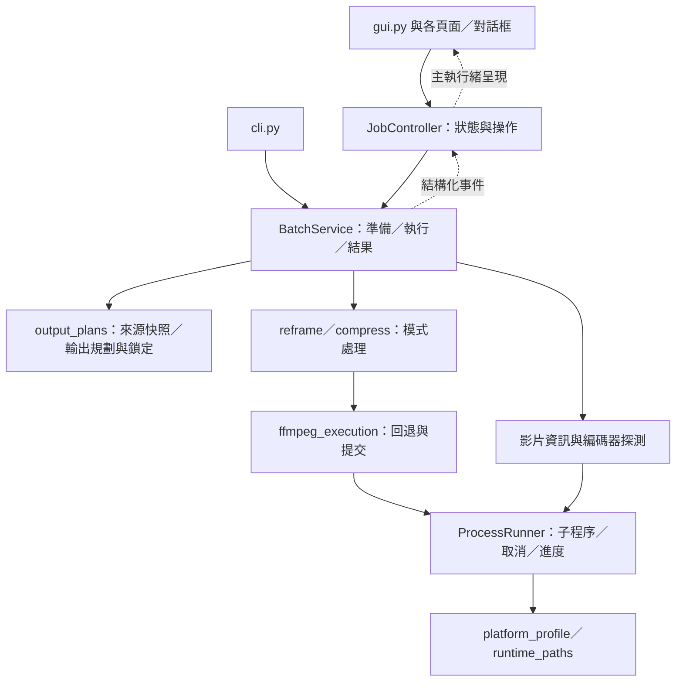

# 穩定性、使用者體驗與跨平台重構計劃

狀態：六個階段的程式工作已實作於 v3.0.14；實機驗收仍依第 8 節列管。原提案檢查基準：`76538ab`，2026-11-09。

建議保留 Python、FFmpeg、Tkinter 與現有處理核心，採逐步抽離的方式重構。
第一個交付重點是「可以安全停止、清楚知道處理結果、不同平台行為可驗證」，
接著改善介面與預覽。是否更換 GUI 框架留待原生驗收有明確證據後評估。

## 1. 現況與優先原因

現有基礎值得保留：`ffmpeg_execution.py` 已共用硬體回退與輸出生命週期；
`output_plans.py` 已有來源快照、碰撞檢查與輸出替換失敗回滾；
`gui_settings.py` 已把設定驗證移出 Tk；CI 已包含三平台測試及三種原生桌面建置。

以下「風險」來自程式碼檢查，未全部經過故障重現；不把原生待驗收項目視為已確認的產品缺陷。

| 優先度 | 現況與依據 | 重構要解決的問題 |
| --- | --- | --- |
| P0 | `gui.py` 共 2,129 行，同時負責 widgets、工作協調、設定、更新及事件分派；狀態由多個布林值管理 | 明確限制可執行操作，降低修改某一頁時影響整個工作流程的風險 |
| P0 | `run_parallel()` 內部建立 `FFmpegCancellation` 並掛在 `position_q`；GUI 無轉碼停止按鈕，工作中關閉視窗只提示等待 | 對外提供完整取消流程，涵蓋掃描、探測、轉碼、回退與輸出提交 |
| P0 | FFprobe／硬體探測使用有逾時的 `subprocess.run()`，但未加入轉碼的取消 registry；FFmpeg 讀取輸出沒有停滯偵測 | 取消時能收回所有受管子程序，長時間無回應時提供可理解的狀態 |
| P0 | `config_store.py` 使用固定 `config.json.tmp`；輸出使用固定 `<final>.tmp`，批次啟動會清理對應 tmp；現有 installer mutex 用於阻擋安裝，未阻擋第二個 app 實例 | 防止多實例互搶暫存檔或覆寫彼此設定；需以雙程序測試驗證 |
| P1 | GUI 的 event queue 無容量上限，`_drain_events()` 每次清空至 queue 為空；畫面日誌已有行數上限 | 大量影片／事件時維持 UI 回應，避免待消化事件無限制累積 |
| P1 | 批次結果是 `(success_count, failed_files)`；略過與真正轉碼成功未在彙總中分開；中斷會由 batch runner 回傳 `(0, [])` | 清楚區分成功、略過、失敗、取消與部分完成，保留已完成成果的資訊 |
| P1 | `ScrollableTab` 有 scrollbar，但沒有滑鼠滾輪／觸控板適配；多處採固定欄寬，原生 DPI 驗收仍待完成 | 改善 Windows 高 DPI、macOS 觸控板、中文字型、鍵盤與小螢幕使用體驗 |
| P1 | `desktop_smoke.py` 會建立 TkDND root 並測試軟體轉碼，但不完整操作 `AutoReframeGUI`；桌面文件的實機驗收矩陣仍為 Pending | 分開驗證核心、完整 GUI、安裝成品與真實 GPU；避免把能打包誤當作體驗已驗證 |
| P1 | 一般 CI test job 未固定 Python；desktop job 固定 Python 3.12，TkDND 要求 Tcl/Tk 8.x | 固定支援的執行組合，讓開發、測試與桌面版使用可比較的環境 |

## 2. 支援範圍與必須保留的行為

主要平台維持 Windows x64、macOS arm64、macOS x64；Linux 是核心與封裝驗證平台。
Windows 11 優先；Windows 10 22H2、macOS 13 的最低支援承諾須完成實機驗收。
Windows ARM64 原生版與 Linux 桌面分發不列入這次重構。

- 維持唯一入口 `python -m auto_reframe_core`、兩種模式與既有 Python API 使用方式。
- 保留上方文字／中央影片／下方文字、不可放大、偶數尺寸、旋轉資訊及浮水印公式等既有契約。
- 保留硬體優先 → 停用硬體解碼 → 軟體編碼的回退順序，以及多目標共用處理分支。
- 保留輸出命名、來源保護、確認後重新驗證、整組 tmp 成功後提交及失敗回滾。
- 設定與使用者資料路徑保持既有規範；本次不引入舊版入口、舊設定匯入或工作區遷移。
- 維持未簽署安裝檔與桌面手動更新政策；來源更新器的 URL、digest、manifest、解壓縮與回滾檢查保持完整。

## 3. 目標結構

以明確資料與少量服務物件分開責任，不引入大型框架或外掛系統。
新增模組初期維持在 `auto_reframe_core/` 同一層，符合現有 source Release 的 `*.py` allowlist。

具體邊界：

| 模組／概念 | 責任 |
| --- | --- |
| `job_models.py` | 不含 Tk 的 `JobRequest`、`TaskContext`、`JobEvent`、`VideoResult`、`BatchResult`；包含 job ID、來源身分、各目標結果與錯誤種類 |
| `job_controller.py` | 管理掃描、準備、確認、執行、取消、完成與關閉；更新操作以明確互斥規則協調 |
| `batch_runner.py` | 演進為 GUI／CLI 共用的服務，使用已固定的來源與設定快照，彙整結果 |
| `process_runner.py` | 啟動、登錄、逾時、終止、回收子程序；FFmpeg、FFprobe 與編碼器探測共用 |
| `gui.py`、`gui_*_view.py`、`gui_dialogs.py` | 啟動組裝、widgets、顯示與使用者操作；不直接執行轉碼或管理輸出交易 |
| `platform_profile.py`、`runtime_paths.py` | 平台辨識、worker 上限、原生開啟、程序旗標及資源／資料位置的既有分工 |
| `output_plans.py`、`output_locks.py` | 保留統一的輸出命名與路徑驗證，增加跨程序輸出所有權 |

把 `active_maps` 中依索引存取的 tuple 逐步改成具名、不可變資料物件；
先保留既有命令與輸出等價測試，再轉換內部表示。純幾何、文字與 graph 模組不依賴 GUI。
新內部 API 使用完整結果物件，既有 `VideoReframer.run()`／`VideoCompressor.run()`
由薄包裝保持既有回傳契約，避免把介面升級與內部拆分綁成一次大改。

## 4. 實作順序與驗收

### PR 1 — 固定基線與測試環境（P0，約 1–2 開發日）

- 固定一般 CI 的 Python 支援版本，記錄 Python／Tcl／Tk／TkDND／FFmpeg 與 OS／CPU。
- GUI job 明確要求 Tk 8.x 與可建立 TkDND root；環境缺漏應使該 job 失敗，不以整批 GUI skip 充當成功。
- 整理既有行為守衛與合成影片案例：中文字、旋轉、多目標、無音訊、浮水印、取消、回退及 promotion 回滾。
- 從第一天開始收集原生安裝／DPI／GPU 證據，不等所有程式完成後才找機器。

驗收：三平台核心測試及指定的 GUI 測試能明確區分通過、跳過與環境失敗；
既有受保護測試不被削弱。合成媒體留在暫存目錄，不使用個人影片。

### PR 2 — 工作狀態、結果與完整取消（P0，約 4–6 開發日）

- 先加入結果物件與 controller，再接 GUI「停止處理」及「停止後關閉」；不在 Tk 主執行緒等待 join 或終止程序。
- 由工作入口建立 `TaskContext`，明確傳遞取消狀態；移除依賴 queue 動態屬性的內部耦合。
- 取消涵蓋資料夾掃描、逐檔 preflight、FFprobe、編碼器探測、排隊任務、FFmpeg 與 promotion。
- 採用 `準備 → 等待確認 → 執行 → 取消中 → 結束` 的合法轉移；完成結果區分成功、部分失敗與取消。
- 子程序共用 terminate → 期限後 kill → wait/reap；取消後不開新重試、不提交未完成輸出。
- 將進度來源從解析人類可讀的 `time=` 日誌改為 FFmpeg `-progress` 的結構化輸出；分別持續讀取進度與 stderr，避免 pipe 堵塞。100% 轉碼後仍顯示「正在確認／提交輸出」，提交成功才顯示完成。
- 保留探測逾時；轉碼加入可觀察的停滯狀態與手動取消。硬性停滯門檻須由長片／慢碟測量決定，不能因慢速合法轉碼而誤殺。

驗收：在探測、轉碼、回退、提交邊界發出取消，所有受管程序都結束，tmp 正確清理，
已完成檔案保留；取消結果不顯示成成功或一般失敗。以本機合成案例為基準，
按鈕回饋目標小於 200 ms，受管程序取消目標 5 秒內完成；外接／網路磁碟異常另測並記錄。

### PR 3 — 多實例、設定與輸出可靠性（P0，約 3–5 開發日）

- 對實際輸出集合取得跨程序鎖，GUI 與 CLI 使用同一機制；採固定取得順序，衝突時指出被其他工作占用的目的地。
- 鎖涵蓋 tmp 清理、轉碼與 promotion；只清理本工作有權管理的 tmp。採程序結束會釋放的鎖，避免只憑殘留檔名判斷工作仍在執行。
- 設定使用同目錄唯一暫存檔再 replace，並以鎖內版本／內容檢查處理多實例寫入衝突；僅換 tmp 名稱不足以避免設定互相覆蓋。
- 設定損壞時提供「查看問題、保留原檔後使用預設」復原入口，未知版本明確報錯；不靜默覆蓋。
- 將磁碟已滿、拒絕存取、Windows 檔案被占用、來源改變等轉成明確錯誤。只對可恢復的錯誤有限重試，保留原始診斷。
- 核對剩餘空間並說明估算限制，處理備份退回完整複製時的空間需求。

驗收：兩個獨立程序對同一輸出競爭、同時儲存設定、磁碟滿及中途替換失敗皆有測試；
無原始檔損壞、無跨工作 tmp 刪除、無靜默設定覆蓋。現有多檔回滾只保證程式可處理的失敗，
不宣稱突然斷電時整組檔案具備檔案系統交易原子性；重啟後殘留物必須可辨識且不可盲目刪除。

### PR 4 — 拆分 GUI 與改善事件處理（P1，約 3–4 開發日）

- 依檔案清單、模式設定、處理進度、更新對話框逐頁抽離；`gui.py` 保留啟動與組裝。
- 一次只改一個邊界，先保持外觀與操作結果，再調整互動。
- 所有事件帶 job ID；忽略過期工作事件，控制完成／錯誤／取消事件只套用一次。
- 每次 Tk drain 設定時間或筆數預算，合併同影片的高頻進度。完成／錯誤等事件不可丟失；佇列達限時不可讓取消流程死鎖。
- 用結構化 logger／事件取代工作期間全域 `redirect_stdout`／`redirect_stderr`；本機日誌輪替，診斷匯出避免夾帶影片、文字與完整個人路徑。

驗收：模擬 1,000 個工作與連續事件時，佇列／記憶體有上限，完成事件無遺漏；
參考機器的 UI 事件延遲 p95 目標低於 200 ms。測試從使用者操作與結果驗證，不依賴私有函式搬到哪個檔案。

### PR 5 — 原生平台互動一致性（P1，約 3–5 開發日）

- 平台分支集中使用 profile，既有 `runtime_paths` 保持路徑職責；補測大小寫、Unicode NFC/NFD、空白、單引號、長路徑、UNC 與外接磁碟。
- 保留保守的輸出碰撞拒絕策略，不對所有平台一律改寫檔名或轉小寫；不同檔案系統語意在原生環境驗證。
- 建立共用 Tk 樣式／字型／間距，欄寬可伸縮；測 Windows 100%、125%、150%、200% DPI 與跨螢幕移動。
- 加入焦點／游標所在區域的滑鼠滾輪與 macOS 觸控板捲動，避免全域綁定搶走文字編輯器事件。
- 補齊 Windows Ctrl、macOS Command 快捷鍵、Tab 焦點、Escape 關閉對話框與中文輸入法體驗。
- TkDND 載入失敗時以可見訊息降級到「加入檔案／資料夾」，保留轉碼能力；正式成品 gate 仍要求 TkDND 成功，不用降級掩蓋打包問題。

驗收：Windows 與兩種 macOS 架構皆完成拖曳多檔、多資料夾、中文輸入、鍵盤操作、捲動及小螢幕測試；
Windows app 與安裝器各自有 DPI 證據。按鈕、文字、勾選框均可見且可操作。

### PR 6 — 操作回饋、預覽與失敗重試（P1／P2，約 3–5 開發日）

- 開始前呈現來源數、實際輸出尺寸、codec、目的地與既有檔案動作，欄位錯誤就地提示並保留輸入。
- 結果清楚區分轉碼完成、略過、失敗、取消；提供「開啟輸出位置」「查看原因」「只重試失敗項目」。
- 重試重新驗證來源與目的地，不盲目沿用過期 preflight；未經使用者確認不重跑取消項目。
- 提供非同步單幀預覽，可選時間點；共用正式 geometry／graph，展示裁切、上下文字與浮水印。快照工作可取消，連續變更設定時合併請求。
- 展示實際編碼器及回退原因。worker 預設先保留既有上限，再根據 GPU session、記憶體與 4K 批次測量決定保守的資源策略。
- 追加跨播放器測試，保留 H.265 `hvc1`、AAC 與 faststart；HDR／10-bit 先偵測並說明處理能力，色調映射或保留 HDR 作獨立功能決策。

驗收：預覽與正式輸出位置一致；失敗重試只執行選定項目；H.264 基準輸出在平台內建播放器可播放。
H.265 相容性依 OS／解碼器實測記錄，不承諾所有 Windows 環境均內建支援。
預覽屬 P2，可在 P0／P1 穩定性里程碑之後交付。

## 5. 跨平台驗收矩陣

既有建置流程繼續執行；新增的是完整 GUI 操作與原生證據，不是重建一套發布系統。

| 層級 | 平台／環境 | 必要案例 | 能證明的範圍 |
| --- | --- | --- | --- |
| 核心測試 | Linux、Windows、macOS；固定 Python | 幾何、設定、路徑、取消、回退、輸出鎖與回滾 | 邏輯與失敗分支 |
| GUI 整合 | Linux Xvfb + Tk 8.x；Windows／macOS 原生 Tk | 實際啟動 AutoReframeGUI、設定、檔案清單、開始／取消、錯誤復原 | 主執行緒邊界與完整操作流程 |
| Frozen 成品 | windows-x64、macos-arm64、macos-x64 | 清空 PATH、字型、TkDND、兩模式與兩 codec、中文路徑 | 隨附資源與打包完整性 |
| 實機安裝 | Win11；Win10 22H2 待證明；macOS arm64/x64，最低 OS 候選另測 | 兩種安裝範圍、首次啟動、升級、移動 app、解除安裝保留資料 | 原生安裝與資料生命週期 |
| 原生 UX | Windows 四種 DPI；macOS Retina／外接螢幕 | 拖曳、觸控板、中文輸入法、快捷鍵、縮放、焦點 | 使用者可見體驗 |
| 真實硬體／媒體 | 可取得的 NVENC／AMF／QSV／VideoToolbox | 硬體成功、故障回退、取消、多目標、長片、旋轉、VFR、無音訊 | GPU、解碼與播放器相容性 |

每份證據附版本、commit、OS、CPU、GPU、Python／Tk、縮放比例及結果。
合成媒體優先；未取得硬體的組合保持「待驗收」。目前不以 Linux 測試宣稱 DMG／Setup.exe 已通過。

## 6. 交付方式與估算

以一位熟悉專案的開發者估算，上述工作約 17–27 開發日，約 4–6 週；
原生設備取得、最低 OS 驗證及 GPU 問題排除時間另計。這是排程參考，不是完成承諾。

推薦第一個里程碑交付 PR 1–3：取消、結果可信與多實例資料保護。
第二個里程碑交付 PR 4–5：GUI 可維護性及跨平台互動。
第三個里程碑交付 PR 6：結果操作與預覽。原生驗收貫穿所有里程碑。

每個 PR 必須保持可執行、可測試、可回退；拆模組與改行為分開審查。
需要改 source Release allowlist、PyInstaller 收集或更新器的 PR，另跑封裝與 staging 驗證。
不混入版號調整或發布操作；功能通過原生 gate 後再安排發布。

## 7. 本次檢查與驗證範圍

- 已檢查 GUI、處理生命週期、輸出／設定儲存、平台路徑、編碼器、CI 與桌面驗收文件。
- 已執行 `python -m unittest discover -s tests`：收集 169 項，159 項通過，10 項跳過，無失敗。
- 10 項為 `WatermarkGUISavingBehaviorTests`；測試前置檢查無法建立 TkDND root。
  本環境缺少 `tkinterdnd2`、沒有 DISPLAY，且 Python 使用 Tcl/Tk 9.0，與產品要求的 8.x 不一致。
- 此次未安裝／更換環境依賴，未完成互動 GUI、Windows／macOS 安裝器、DPI 或 GPU 實機驗證。
- 此變更僅新增本計劃文件，未修改應用程式行為。

## 8. v3.0.14 實作與驗證對照

本次使用者另外要求自訂輸出子資料夾、設定自動移至 Application Support，並保留五個版本的相容期及執行 release；這些明確要求優先於第 2／6 節原提案的「不遷移／不發布」。

| 階段 | 已實作項目 | 可重現驗證與證據 |
| --- | --- | --- |
| PR 1 | CI／Release／desktop 共用 Python 3.12；強制 Tk 8.x／TkDND GUI gate；記錄完整 runtime | `scripts.check_runtime`、CI runtime artifacts、原有行為守衛及合成媒體測試 |
| PR 2 | `job_models`、`JobController`、`TaskContext`、`BatchService`；停止及停止後關閉；掃描／探測／回退／轉碼／提交取消 | `test_job_services`、`test_cancellation`、`test_processing_lifecycle`、實際 GUI 停止按鈕測試 |
| PR 2 | `ProcessRunner` 共用 registry／terminate／kill／reap；FFmpeg stdout 使用 `-progress`，stderr 獨立排空；提交與停滯狀態 | 真實子程序取消／逾時、大量 stderr、結構化進度、停滯但不誤殺測試 |
| PR 2 | 具名不可變 `OutputTarget`；每影片及每目標結果；`run_result()` 與舊 `run()` 薄包裝 | 真實轉碼後再略過、取消排隊任務保留既有成功、graph 及 API 守衛 |
| PR 3 | 實際輸出集合跨程序鎖，固定順序取得，涵蓋 tmp 清理到提交；OS 自動釋放 | 獨立子程序競爭、崩潰釋放、另一工作 tmp 不被刪除測試 |
| PR 3 | 唯一設定暫存檔／fsync／replace，鎖內 revision 比對，問題設定保留原檔後復原 | 兩個獨立程序同時儲存只有一個成功；損壞、未知版本、磁碟滿及復原測試 |
| PR 3 | 明確錯誤種類、Windows sharing violation 有限重試、來源改變檢查、磁碟／備份容量估算 | 既有多檔回滾及失敗注入測試；取消中的備份可中止 |
| PR 3 | 輸出交易 journal；中斷殘留需先檢查，保留可復原備份 | `.arv-transaction-*.json`，不宣稱突然斷電時具有多檔原子性 |
| PR 4 | 拆成 files／modes／settings／activity／update／job／results／preview views，入口僅組裝 | 原有完整 GUI 設定、清單、主執行緒邊界測試保留 |
| PR 4 | job ID 過濾、完成事件只套用一次、128 筆／8 ms drain、進度合併、有界佇列 | 1,000 工作及連續事件壓力測試，terminal 無遺失；取消不等候佇列 |
| PR 4 | 不再全域 redirect stdout／stderr；結構化事件與輪替本機日誌；資料最少化診斷匯出 | 匯出不含完整路徑、檔名、文字或原始 stderr 的測試 |
| PR 5 | profile 集中平台決策、保守大小寫／Unicode 身分、共用樣式、可伸縮欄位、Windows DPI awareness | 既有跨平台路徑守衛；中文、空白、單引號合成案例；原生檔案系統及 DPI 待實機確認 |
| PR 5 | 區域滑鼠／觸控板捲動、Ctrl／Command 快捷鍵、Tab／Escape；TkDND 可見降級 | GUI 操作及正式成品 TkDND 強制 gate；IME／Retina／跨螢幕待實機確認 |
| PR 6 | 實際尺寸／codec／目的地／既有檔案動作／HDR 限制確認；錯誤就地保留輸入 | 既有確認與設定驗證測試；完整 GUI smoke |
| PR 6 | 結果動作、查看原因、選定失敗來源重試，重新 preflight，不自動重跑取消項目 | 失敗來源選取／新快照測試，已產生輸出數獨立保留 |
| PR 6 | 非同步可取消單幀預覽，選時間及目標，共用正式 graph，350 ms 合併設定變更 | 合成預覽尺寸與正式規劃一致，最新請求取消舊請求；不建立正式輸出目錄 |
| PR 6 | 實際 encoder／回退原因；保留 worker 上限、hvc1／AAC／faststart，提示 HDR／10-bit | 真實 H.264／H.265 frozen smoke、既有 graph 守衛、faststart 及 8-bit 檢查 |
| 額外需求 | `output_subfolder` GUI／CLI／Python API 及持久化，套用兩種模式／兩種輸出位置 | 名稱／路徑拒絕、快照變更、中文 GUI 及來源保護測試 |
| 額外需求 | v3.0.14～v3.0.18 自動遷移；v3.0.19 起停用，屆時移除模組及呼叫點 | 五版本邊界、原檔刪除失敗回滾、新設定優先、文字／字型／選定 PNG 保留測試 |

本機已用 Linux x86_64、Python 3.13.5、Tcl/Tk 8.6.16、TkDND 2.9.4、FFmpeg 7.1.5 執行完整測試、完整 GUI 及清空 PATH 的 frozen smoke。這是額外開發環境證據；正式固定 Python 3.12 的三平台結果由本次 CI artifacts 提供。所有媒體為暫存合成案例。

Windows 11／10 22H2 實機安裝、兩種安裝範圍、升級／解除安裝保留資料、Windows app 與 installer 的四種 DPI、macOS 兩架構與最低 OS、IME／觸控板／外接螢幕、UNC／長路徑／外接碟及真實 GPU／VFR／長片／系統播放器矩陣仍須實機證據。本次沒有可操作的相應設備，不能把 CI smoke 視為這些項目已通過；維持 `DESKTOP_DISTRIBUTION.md` 的 Pending 狀態。

最終本機驗證：206 項單元／整合測試全部通過，無跳過；來源 ZIP 建置與 updater staging、完整 GUI、Linux frozen 清空 PATH smoke、隱私掃描與 Action SHA 檢查通過。原生三平台最終結果以本次 CI 為準。
